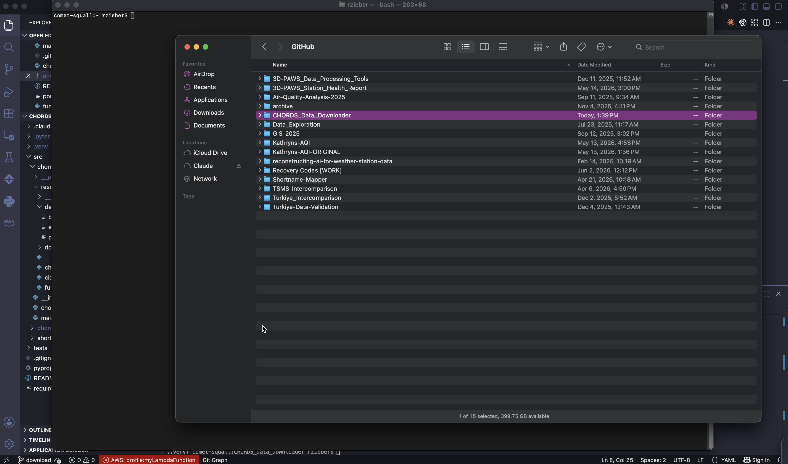

# CHORDS Data Downloader
Automated REST API client for downloading CHORDS meteorological data. Supports CSV export, dataframe export, column filtering, time windows, and all major CHORDS portals.<br><br>
Authored by Rebecca Zieber.

## Prerequisites
- Python **3.9+**
- CHORDS account with **API key** and download privileges

## Quick Start (Windows, macOS/Linux)
1. **Clone/download** this repo<br>
   ```bash
   git clone https://github.com/rzieber/CHORDS_Data_Downloader.git
   ```
2. **Set up virtual environment**<br>
   **On Debian/Ubuntu Linux only**, install it via apt first (it's a system package, not a pip package):
   ```bash
   sudo apt install python3-venv
   ```
   Create the virtual environment — **Windows (PowerShell)**:
   ```powershell
   py -m venv .venv
   ```
   > If no Python is installed, `winget install Python.Python.3.10` will get you one.

   Create the virtual environment — **macOS/Linux**:
   ```bash
   python3 -m venv .venv
   ```
   Activate it — **Windows (PowerShell, not Command Prompt)**:
   ```powershell
   .\.venv\Scripts\Activate.ps1
   ```
   > If you get an error that "running scripts is disabled on this system," open **Windows PowerShell as administrator** (search "PowerShell" in the Start menu, right-click → Run as administrator — this must be PowerShell, not `cmd.exe`, which doesn't have this command) and run once:
   > ```powershell
   > Set-ExecutionPolicy RemoteSigned -Scope CurrentUser
   > ```
   > Then retry the activation command above in a regular (non-admin) PowerShell window.

   Activate it — **macOS/Linux**:
   ```bash
   source .venv/bin/activate
   ```
   **Check:** if everything above worked, your prompt now starts with `(.venv)` — for example `(.venv) PS C:\Users\username\Documents\CHORDS_Data_Downloader>`. If you don't see that, the virtual environment isn't active, and you should go back and re-run the activation step before continuing.
3. **Install dependencies and register command**<br>
   **On Windows**, upgrade pip first — an outdated pip can fail to install some dependencies:
   ```powershell
   python -m pip install --upgrade pip
   ```
   All operating systems:
   ```bash
   pip install -r requirements.txt
   pip install -e .
   ```
4. **Copy and configure .env**<br>
   ```bash
   cp ./src/chords_downloader/resources/dev/env_[EXAMPLE] ./.env
   ```
   > See `/src/chords_downloader/resources/dev` for the template: `env_[EXAMPLE]`.
5. **Update the `.env` file**<br>
   Open the `.env` file you just created in a plain text editor — Notepad on Windows, TextEdit on macOS, or any code editor — and fill in your own values (portal URL, instrument IDs, account email, API key, date range, etc.).
   > See [Configuration](#configuration) below for what each parameter means and how to format it.
6. **Download data**<br>
   ```bash
   chords-download
   ```
   CSV's save to your `DATA_PATH` automatically.

## Tutorials

### Quickstart Powerpoint
The following link opens a powerpoint which explains how to use this script.
[](https://docs.google.com/presentation/d/1QUHa7zO0RMfa6-pFnzFD83u3EulmNKe4pK38sktvxX8/edit?usp=sharing)

### .env Walkthrough
The following link opens a video for download. The tutorial walks you through .env setup and data download.
[](https://drive.google.com/file/d/1PJ9jAbVT6mksEoCJOjCnpMZaL5fbmIh_/view?usp=drive_link)

> **Note:** in the video, the file is named `env` rather than `.env`. That's only because the file browser used to record it can't display files that start with a dot. When you set this up yourself, name the file `.env` — that's what the downloader actually looks for.

## Configuration
Create `.env` from `env_[EXAMPLE]` and fill the required fields:
   - `PORTAL_URL` - the URL associated with your CHORDS portal (see Available Portals below)
   - `PORTAL_NAME` - the name associated with your CHORDS portal (see Available Portals below)
   - `DATA_PATH` - the path where CSV's are to be exported to your local machine. **On Windows, use forward slashes**, e.g. `DATA_PATH=C:/Users/username/Documents/CHORDS` — backslashes in the path can cause issues
   - `INSTRUMENT_IDS` - the instruments to download data for (refer to the available instruments on your CHORDS portal). Accepts a list of integers or a `range()` expression:
     - List: `INSTRUMENT_IDS="[1,2,5,10]"`
     - Range: `INSTRUMENT_IDS="range(1,12)"` → instruments 1–11
     - Range with step: `INSTRUMENT_IDS="range(1,20,2)"` → every other instrument (1,3,5,...,19)
   - `USER_EMAIL` - the email associated with your CHORDS account
   - `API_KEY` - the API associated with your CHORDS account
   - `START` - the start of your desired data period
   - `END` -  the end of your desired data period
   - `OUTPUT` - the type of output you desire, valid selections are: csv, df, or both -> string values
   - `COLUMNS_DESIRED` *(optional)* - the variables to include in the output, given as a comma-separated list of shortnames (refer to the shortnames shown for your instrument on your CHORDS portal). Do not use brackets or quotes around individual names. The `time` column is always included. Leave empty to download all columns (default).
     - All columns: `COLUMNS_DESIRED=""`
     - Subset: `COLUMNS_DESIRED="t1,t2,rh1"` → `time`, `t1`, `t2`, and `rh1` only
   - `TIME_WINDOW_START` / `TIME_WINDOW_END` *(optional)* - restrict the download to a window of time within each day of your `START`–`END` period. Both must be in `HH:MM:SS` format (24-hour clock), both must be set if either is used, and the start must be earlier than the end. The window is inclusive on both ends. Leave both empty to keep all timestamps (default).
     - All timestamps: `TIME_WINDOW_START=""` and `TIME_WINDOW_END=""`
     - Window: `TIME_WINDOW_START="06:00:00"` and `TIME_WINDOW_END="18:00:00"` → only observations from 06:00:00 through 18:00:00 on each day

## Available Portals
- `3D-PAWS`            | `https://3d.chordsrt.com`
- `Barbados`           | `https://3d-barbados.chordsrt.com` 
- `Trinidad`           | `https://3d-trinidad.chordsrt.com`
- `Dominican-Republic` | `https://3d-dr.icdp.ucar.edu`
- `Calibration`        | `https://3d-calibration.chordsrt.com`  
- `FEWSNET`            | `https://3d-fewsnet.icdp.ucar.edu`
- `Kenya`              | `https://3d-kenya.chordsrt.com`  
- `Zimbabwe`           | `https://3d-zimbabwe.icdp.ucar.edu`
- `Argentina`          | `https://3d-argentina.icdp.ucar.edu` 
- `IITM`               | `https://3d-iitm.icdp.ucar.edu`
- `Fiji`               | `https://3d-fiji.icdp.ucar.edu`
- `Bahamas`            | `https://3d-bahamas.icdp.ucar.edu`
- `Malawi`             | `https://3d-malawi.icdp.ucar.edu`
- `Jamaica`            | `https://3d-jamaica.icdp.ucar.edu`
- `Ethiopia`           | `https://3d-ethiopia.icdp.ucar.edu`
- `Somalia`            | `https://3d-somalia.icdp.ucar.edu`
- `Turks-and-Caicos`   | `https://3d-tc.icdp.ucar.edu`
- `Madagascar`         | `https://3d-madagascar.icdp.ucar.edu`

## Troubleshooting
- **"Large data request -- reducing."** during download — this is expected for large date ranges or instrument counts. The downloader automatically splits the request into smaller time segments and retries; a successful run still ends with `Finished writing CSV.` and summary counts.
- **PowerShell won't run the activation script** (`running scripts is disabled on this system`) — open PowerShell as administrator and run `Set-ExecutionPolicy RemoteSigned -Scope CurrentUser` once, then retry activation in a regular (non-admin) window. This must be PowerShell, not `cmd.exe`.
- **`python3` not recognized (Windows)** — Windows typically doesn't have a `python3` command; use `py` instead (e.g. `py -m venv .venv`, or `py -3.10 -m venv .venv` to target a specific version).

## For Contributors
Run the following to test changes before submitting a pull request:
```bash
pytest -v
```
You must include unit tests for your recommended changes in order for suggestions to be incorporated.
